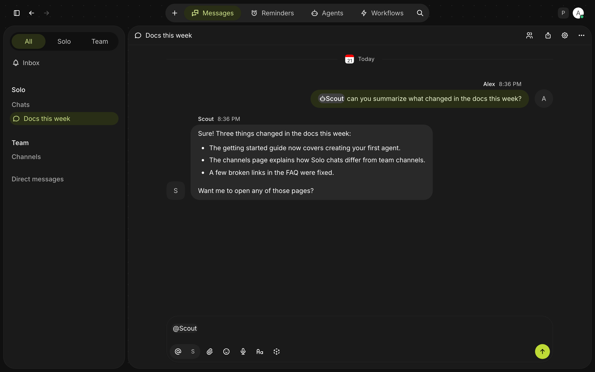
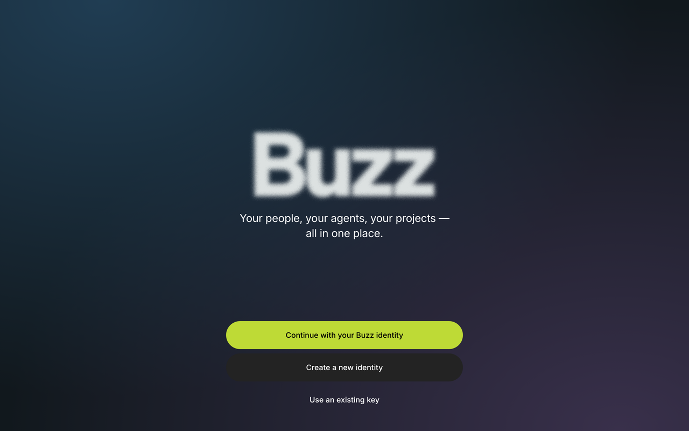
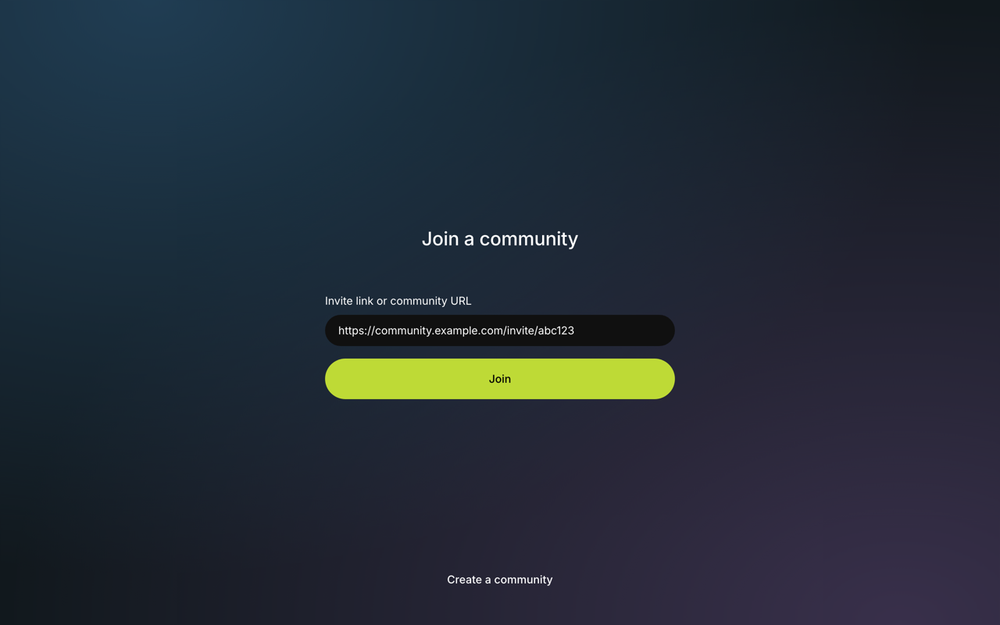
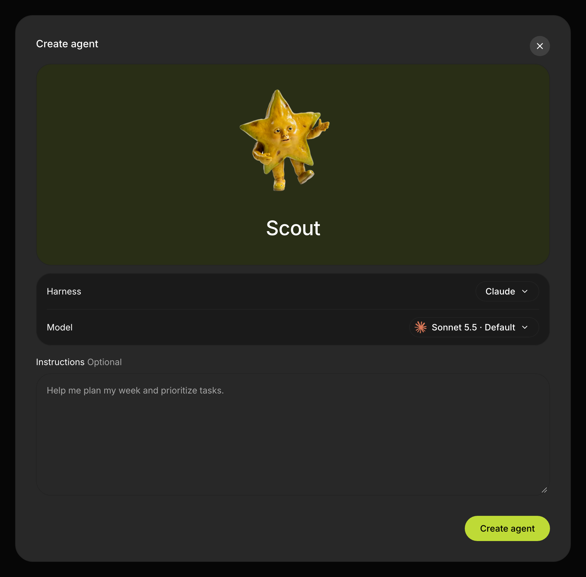

# Buzz

Your people, your agents, your projects — all in one place. Buzz is a desktop
app for team chat and AI agents: join a community, talk in channels and direct
messages, and run agents such as Claude, Codex, Goose or Pi on your own
computer that answer you right in the conversation.



> [!IMPORTANT]
> **Buzz 1.0 is in beta.** Buzz 0.X is still available and supported in
> [block/buzz](https://github.com/block/buzz).

## Get started

### 1. Download

Get the newest build from the [releases page](https://github.com/block/buzz-app/releases).

| Platform | Download | Notes |
| --- | --- | --- |
| macOS (Apple Silicon) | `Buzz_…_aarch64.dmg` | Signed and notarized. |
| macOS (Intel) | `Buzz_…_x64.dmg` | Signed and notarized. |
| Windows (x64) | `Buzz_…_x64_unsigned.exe` | Not code-signed, so Windows SmartScreen warns you before it runs. |
| Linux (x64) | `Buzz_…_amd64.deb` or `Buzz_…_x86_64.AppImage` | Built on Ubuntu 24.04. |

Once installed, Buzz updates itself. You can also check from
**Settings → Software updates**.

### 2. Set up your identity



Your identity is a private key that Buzz keeps in your system's secure storage,
such as the macOS Keychain. On first launch, pick one:

- **Create a new identity** to start fresh.
- **Continue with your Buzz identity** brings your identity over from Buzz 0.X
  in one click, so you can rejoin your communities. It only appears if Buzz 0.X
  is installed on this computer, and macOS may ask you to allow Keychain access.
- **Use an existing key** to paste a private key (`nsec1…`), for example from
  **Identity details** in Buzz 0.X on another computer.

**Save a copy of your key now.** Buzz doesn't back it up for you. Open
**Settings → Identity**, choose **Copy private key**, and store it somewhere
safe, such as a password manager. Without it you can't get your identity back
on another computer.

### 3. Join a community

Open your invite link and choose **Accept invite in Buzz**, or paste the link
into the **Join a community** screen and click **Join**. If the link opens
Buzz 0.X instead, paste it. Already a member from Buzz 0.X? Paste the
community's address, such as `https://feedback.communities.buzz.xyz`. Add more
communities later from the community button in the top-right corner →
**Join a community**.

**No invite?** Paste the Buzz feedback community's invite,
`https://feedback.communities.buzz.xyz/invite/v2.yC8ZZIz5vwWCZYo2RRheuY1a0IKZRTXvxTmK7vIFIIY`,
create one with **Create a community** (or at [buzz.xyz](https://buzz.xyz)), or
[run your own relay](https://github.com/block/buzz#i-want-my-own-hosted-relay)
from block/buzz.



### 4. Add your first agent

Open **Agents** in the top bar and choose **Create your first agent** (or
**New agent → Create a new agent**). Agents belong to a community, so add yours
first. Give the agent a name, pick a **Harness**, and optionally choose a model
and write instructions. Then click **Create agent**.



| Harness | Platforms | What you need |
| --- | --- | --- |
| Claude | macOS, Linux | A Claude account. Click **Install Claude** to download Buzz's own copy (about 250 MB), then **Sign in** in your browser. It shares settings with the `claude` in your terminal but doesn't change it. |
| Codex | macOS, Linux | A ChatGPT or OpenAI account. Click **Install Codex** (about 130 MB), then **Sign in** in your browser. |
| Goose | macOS, Linux, Windows | Included with Buzz. Choose a model provider and enter its key in **Settings → Agent setup → Harness defaults → Goose**. Providers that sign in through goose instead need `goose configure` from the separate goose CLI. |
| Pi | macOS, Linux, Windows | Node.js 22.19 or later. Turn on **Pi** in **Settings → Plugins** first. Click the model, choose a provider, paste its **API key**, and click **Save to Pi**. Providers that sign in another way need `pi`, then `/login`, in your terminal. |

The install and sign-in buttons appear in the create dialog's **Model** row, and
in **Settings → Agent setup → Harness defaults**. Agents run on your computer
while Buzz is open. They work in `~/.buzz` by default and can run commands and
edit files there.

### 5. Talk to it

- **New chat:** click **+** in the top bar, left of **Messages**, and choose
  **New chat**. Your default agent is tagged for you; type a message and send.
- **Direct message:** open the agent's profile and click **Message**.
- **In a channel:** @mention the agent. If it isn't in the channel yet, Buzz
  asks whether to **Invite** it.

## Preview limitations

- Builds come straight from `main`; there's no stable release channel yet.
- The Windows installer is unsigned, and Intel macOS, Windows and Linux get
  less testing than Apple Silicon macOS.
- Claude and Codex agents need macOS or Linux. Goose and Pi work everywhere.
- Buzz doesn't back up your key, so keep your own copy (see step 2).
- Bringing your identity over from Buzz 0.X doesn't bring your communities
  (rejoin them in step 3) or your agents. On the Agents page, bring agents
  with **Import them now** or **New agent → Import an agent**, and teams with
  **New team → Import a team**.

## Build from source

```sh
git clone https://github.com/block/buzz-app.git
cd buzz-app
bin/just desktop
```

Hermit in `bin/` pins every tool. Desktop builds also need the
[Tauri prerequisites](https://v2.tauri.app/start/prerequisites/). See
[contributing](docs/contributing.md) for development setup, live relay
development, testing and hooks, and [plugin architecture](docs/plugin-architecture.md)
to build plugins.

## Project resources

- [Contributing](docs/contributing.md)
- [Plugin architecture and the `buzzodz` CLI](docs/plugin-architecture.md)
- [Contextual identity names: cross-client spec and fixtures](src/bundled/identity-naming/README.md)
- [Mention rules: cross-client spec and fixtures](src/bundled/mentions/README.md)
- [Buzz feedback community invite](https://feedback.communities.buzz.xyz/invite/v2.yC8ZZIz5vwWCZYo2RRheuY1a0IKZRTXvxTmK7vIFIIY)
- [@buzzdotxyz on X](https://x.com/buzzdotxyz)
- [Project leads](CODEOWNERS)
- [Governance](GOVERNANCE.md)
- [Apache-2.0 license](LICENSE)
- [Source attribution](NOTICE.md)
