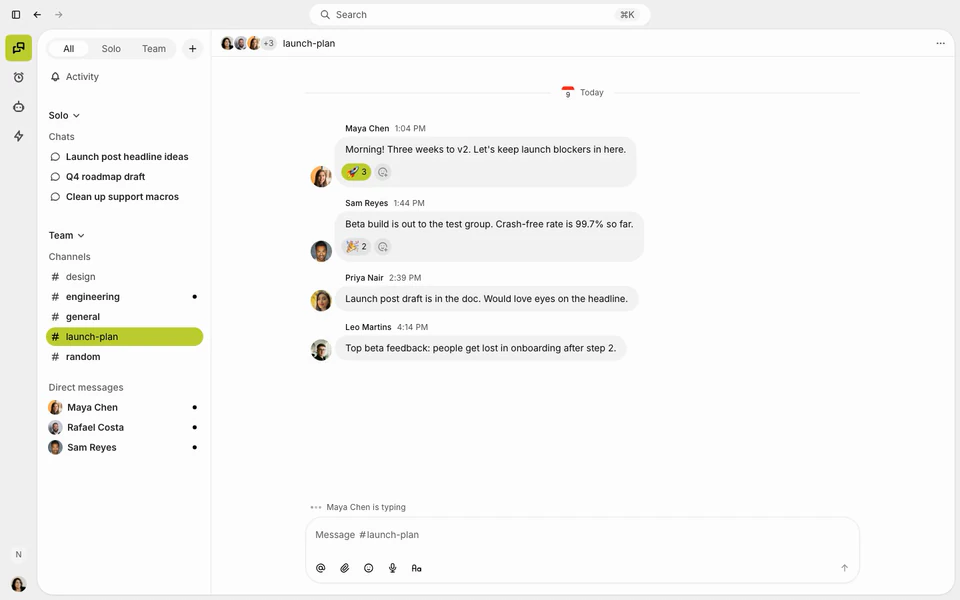

# Upgrading from the old Buzz app

This page is for people using the Buzz desktop app from
[block/buzz](https://github.com/block/buzz). The new Buzz app lives here, in
block/buzz-app. It adds plugins and remote agents.

## Get the new app

Download the latest release from [buzz.xyz](https://buzz.xyz) or view
[all releases](https://github.com/block/buzz-app/releases). Available for
macOS, Windows and Linux.

The old app's updater does not deliver the new app, so this is a fresh install.

## What's new

### Plugins

Buzz is now built on plugins, so anyone can make it work the way they want. The
core of the app is made of plugins too:

- **Messages**: channels, direct messages and threads.
- **Agents**: where you create and manage agents.
- **Claude** and **Codex**: each agent integration is its own plugin.
- **Huddles**: audio conversations.

Plugins you add use the same building blocks, so they can go as far as the
built-in ones.

### Remote agents

Close your laptop and your agent keeps working. A remote agent runs on a hosted
machine instead of your computer, so it can still answer when Buzz is closed.

Builderlab, the hosted service built into Buzz, runs these agents. You sign in
with a Builderlab account to use them.

Local agents still work as before.

## Next steps

New to this app? The [README](../README.md) covers getting started.
